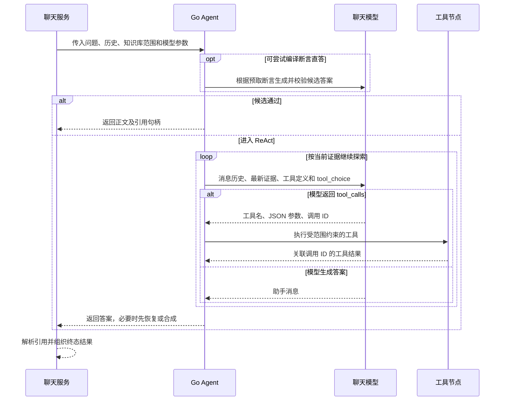

# RAGFlow Agentic 聊天执行流程与工具参考

普通聊天入口在选择 Agentic 模式且绑定知识库时，进入 Go 后端的 Agentic RAG 分支。一轮请求可能由预取的编译断言直接回答，也可能进入 Eino ADK 的 ReAct 工具循环。仓库注册了 **13 个可配置工具**，默认模板列出 **8 个**。此外还有由联网设置动态注入的 `web_search`。

本文以当前仓库的 Go 实现和自带配置为准。运行中的实例还会受环境变量、会话覆盖、知识库产物及模型供应商能力影响。

## 1. 请求入口与模式选择

1. 普通聊天请求进入 `POST /api/v1/chat/completions`。Handler 解析消息、问题、会话 ID 和模型参数，交给聊天会话服务。会话服务组织消息后调用 `ChatPipelineService.AsyncChat`。 [HTTP 入口](../../internal/handler/chat_session.go#L164) · [会话服务](../../internal/service/chat_session.go#L1284)
2. `AsyncChat` 在普通检索和生成阶段之前判定模式。请求含字符串类型的 `agent_mode`，或解析出的 `reasoning_level` 为 Agentic（值 `5`），且会话绑定了知识库时，进入 `agenticRag`。请求的推理级别优先于会话配置。没有绑定知识库时，按普通聊天的其他分支处理。模型参数 `thinking` 控制模型推理设置，Agentic 路由由模式和推理级别控制。 [分支选择](../../internal/service/chat_pipeline.go#L268) · [推理级别](../../internal/service/chat_pipeline.go#L5091)
3. `resolveChatAgenticTemplate` 按请求选择模板，未指定时使用 `smart-reasoning`。仓库默认的模板名为 Progressive Agentic RAG，温度为 `0.5`。默认模板文件为 `conf/agentic_rag.yaml`，可通过 `AGENTIC_RAG_CONFIG` 指定其他文件，文件变更后按修改时间重新加载。无效模板 ID 会报错。 [模板解析](../../internal/service/agentic_pipeline.go#L48) · [配置加载](../../internal/agentic_rag/config.go#L112) · [默认模板](../../conf/agentic_rag.yaml#L1)
4. 会话的 `prompt_config.agentic_rag` 可以覆盖提示词和工具清单。覆盖工具时启用严格选择，校验注册名称、重名、至少一个语料搜索工具和 `list_chunks`。只覆盖提示词时仍沿用默认的工具装配规则。 [覆盖验证与应用](../../internal/agentic_rag/override.go#L64)

## 2. 初始化模型、权限与预算

| 项目 | 本轮如何初始化 |
|---|---|
| 聊天模型 | 用会话选定模型，缺省时解析租户默认模型。追加 `llm_setting.failover_llm_ids` 中可解析的备用模型。含图像输入时只保留具备视觉能力的模型。本轮给探索和备选合成分别创建 Eino 模型实例，使用同一组候选模型。模板明确声明温度时，覆盖普通聊天参数的温度。 |
| 检索范围 | 将会话绑定的知识库、按元数据得出的文档范围、租户及实际用户身份传入 Agent。对使用范围校验的工具，模型只能缩小范围。文档范围为 `nil` 时允许在知识库中查找，显式空列表则代表过滤后无可用文档。 |
| 引用和计量 | 为本轮建立证据注册表、Token 使用统计及工具调用计数。注册表把送给模型的证据句柄映射回原文分块或网页结果。 |
| 运行边界 | 一轮探索受 **15 分钟**的请求预算、默认 **500,000 Token** 和默认 **120 次 ReAct 迭代**约束。Token 与迭代可分别通过 `RAGFLOW_AGENTIC_TOKEN_BUDGET` 和 `RAGFLOW_AGENTIC_MAX_ITERATIONS` 配置。备选合成使用独立的短时预算。 |

[会话初始化](../../internal/service/agentic_pipeline.go#L108) · [模型与参数](../../internal/service/agentic_pipeline.go#L192) · [模型链解析](../../internal/service/agentic_pipeline.go#L447) · [范围校验](../../internal/agentic_rag/helper.go#L100) · [迭代上限](../../internal/agentic_rag/agent.go#L125)

## 3. 工具怎样进入本轮

| 来源 | 装配规则 |
|---|---|
| 默认模板 | 从 YAML 的 `tools` 逐个构建工具实例。知识库工具在构建时绑定租户和数据集。 |
| 自定义模板或会话覆盖 | 可显式选用注册表里的工具。没有写工具清单的非严格模板可回退到注册表全集。内部调用方也可通过 `Input.Tools` 传入工具实例。 |
| 编译产物注入 | 普通装配过程中，如果绑定知识库存在带 `compile_kwd` 的产物，就注入 `graph_explore` 和 `graph_doc_outline`。显式传入工具或采用严格工具清单时，跳过这一步。产物探测检验的是编译记录，图谱工具实际执行时还会检查相应图谱数据。 |
| 联网注入 | 本轮允许联网且配置了可用搜索提供商时，由聊天服务把搜索函数注入上下文，再装配 `web_search`。它独立于模板的静态工具清单。 |
| 会话级可用性 | 如果图谱工具确认绑定范围缺少所需图谱，会记录不可用状态。后续装配可移除对应工具。一次查询没找到相关实体时，可以换实体名重试。 |

[注册表与装配](../../internal/agentic_rag/config.go#L76) · [工具选择](../../internal/agentic_rag/config.go#L228) · [编译产物探测](../../internal/agentic_rag/compiled_knowledge.go#L66) · [联网工具](../../internal/agentic_rag/tool_web_search.go#L82) · [不可用工具过滤](../../internal/agentic_rag/agent.go#L460)

## 4. 完整工具清单

「默认」指当前仓库 `smart-reasoning` YAML 中的明确配置。「按需注入」和「可显式启用」描述运行时提供给模型的条件。下表列出主要入参，可选字段及限制见各工具的 `Info` JSON Schema。

| 工具 | 默认可用性 | 主要入参 | 功能与返回内容 |
|---|---|---|---|
| `grep_chunks` | 默认 | `query`，可选 `doc_scope`、`dataset_ids`、`intent` | 用正则定位原文分块，返回匹配片段及定位信息，适合精确名称、编号和固定短语。 [源码](../../internal/agentic_rag/tool_grep_chunks.go#L62) |
| `search_bm25_chunks` | 默认 | `queries`（1–5 条），可选 `top_n`、范围、`intent` | 纯词法 BM25 召回，返回排序后的分块命中。当前默认模板下，它是检索门槛优先选中的语料工具。 [源码](../../internal/agentic_rag/tool_search_bm25_chunks.go#L47) |
| `search_semantic_chunks` | 默认 | `queries`（1–5 条），可选 `top_n`、`similarity_threshold`、范围、`intent` | 纯向量召回，适合文档用词与用户表述不同的情况。 [源码](../../internal/agentic_rag/tool_search_semantic_chunks.go#L48) |
| `search_chunks` | 可显式启用 | `queries`，可选 `top_n`、`similarity_threshold`、`keywords_similarity_weight`、范围、`intent` | 混合文本与向量召回。可作为首轮语料检索候选，也可供模型在探索阶段选用。 [源码](../../internal/agentic_rag/tool_search_chunks.go#L52) |
| `search_metadata` | 默认 | `filters` 中的 `key/op/value`，可选 `logic`、`dataset_ids` | 根据文档元数据筛选文档，返回可供后续检索和精读使用的文档 ID。 [源码](../../internal/agentic_rag/tool_search_metadata.go#L74) |
| `list_chunks` | 默认 | `doc_id`、`anchor_chunk_ids`，可选 `number_neighbors`、`raw`、`intent` | 读取一个文档内的锚点原文，可扩展前后邻块，返回正文和可用引用。适合核实检索片段里的具体条款或数值。 [源码](../../internal/agentic_rag/tool_list_chunks.go#L56) |
| `graph_explore` | 按编译产物注入，也可显式启用 | `query`，可选 `dataset_ids`、`doc_scope` | 从相关实体出发沿关系扩展，返回有数量上限的实体、关系和来源段落。适合关系查询及跨节点探索。 [源码](../../internal/agentic_rag/tool_graph_explore.go#L36) |
| `graph_doc_outline` | 按编译产物注入，也可显式启用 | `doc_ids` 或 `query`，可选 `dataset_ids` | 返回相关文档的图谱骨架。只给查询时先定位文档，再读该文档的结构。 [源码](../../internal/agentic_rag/tool_doc_outline.go#L123) |
| `navigate_tree` | 可显式启用 | `query`，可选 `keywords`、`dataset_ids`、`doc_scope` | 按查询检索知识库的编译导航树，返回匹配文档及简要结构，供下一轮深入检索。 [源码](../../internal/agentic_rag/tool_navigate_tree.go#L37) |
| `navigate_structure` | 可显式启用 | `query`、`doc_id` 或 `doc_ids`，可选 `kind`、`keywords`、`dataset_ids` | 深入指定文档的编译结构，按实现支持的产物与查询返回大纲或断言及来源。 [源码](../../internal/agentic_rag/tool_navigate_structure.go#L50) |
| `think` | 默认 | `thought`、`thought_number`、`total_thoughts`、`next_thought_needed` 等 | 记录一次模型主动提交的规划或复盘步骤，返回本次步骤的结构化反馈。 |
| `todo_write` | 默认 | `steps`（含 ID、描述和状态），可选 `task` | 把模型提交的任务计划格式化为工具反馈，可在多步研究中更新计划。 |
| `run_javascript` | 默认 | `code` | 通过隔离的 Goja 环境做算术计算或处理已拿到的数据，输出由 `console.log` 收集，执行时间和输出受限。 |
| `web_search` | 按联网能力注入 | `queries`（1–3 条） | 调用本轮配置的公网搜索提供商，返回网页结果、URL 和本轮引用句柄。 |

[think](../../internal/agentic_rag/tool_think.go#L70) · [todo_write](../../internal/agentic_rag/tool_todo_write.go#L117) · [JavaScript 沙箱](../../internal/agentic_rag/tool_run_javascript.go#L111) · [联网检索执行](../../internal/agentic_rag/tool_web_search.go#L169)

## 5. 编译断言直答分支

进入 ReAct 前，`Run` 在普通工具装配下尝试预取编译断言。预取会检查知识库是否有 claim 产物，并结合原文召回与断言检索，找有出处的候选证据。具体检索腿由实现和配置决定。显式传入工具或严格工具清单时跳过这条分支。

找到候选后，`answerFromClaims` 先让模型判断证据是否足够并尝试回答，接着检查回答是否带引用、推导是否引用至少两个不同的证据句柄，再调用模型核对证据支持度。明确的证据不足、校验拒绝或调用错误会转入 ReAct；校验输出无法解析时，当前实现记录告警并放行候选。直答通过时，直接结束本轮，工具调用数可以为零。 [预取](../../internal/agentic_rag/compiled_evidence.go#L596) · [直答分支](../../internal/agentic_rag/agent.go#L393) · [生成和校验](../../internal/agentic_rag/agent.go#L1151)

## 6. ReAct 探索和工具调度

1. **初始化会话。** 创建请求内的 managed session，把会话历史和本轮问题传给 Eino Runner。模型绑定本轮工具 Schema，工具节点负责实际执行。 [Runner 建立与启动](../../internal/agentic_rag/agent.go#L485) · [会话消息组织](../../internal/agentic_rag/run_session.go#L93)
2. **先满足本轮检索门槛。** `retrievalModel` 从启用的语料搜索工具中，按 `search_bm25_chunks → search_chunks → grep_chunks → search_semantic_chunks` 取第一个作为必经工具。如果有 `web_search`，联网检索也是必经工具。包装器检查本轮最近用户消息之后的工具调用和响应，缺哪个就用命名 `tool_choice` 强制哪个。满足条件后允许模型自行决定是否继续。这里检查的是是否收到配对工具响应，证据是否充足仍由后续逻辑判断。图谱工具有机会在后续由模型选择。 [检索门槛](../../internal/agentic_rag/retrieval_model.go#L37)
3. **模型提交调用，Go 执行。** 模型返回 `tool_calls`，每个调用携带工具名、参数和 ID。同一轮的多个调用可并行。工具节点执行后将结果放回对话，后续模型请求读取这些结果，决定改写查询、补充检索、读原文或回答。命名 `tool_choice` 需要上游模型服务支持相应的工具调用协议。 [工具并发配置](../../internal/agentic_rag/agent.go#L495)
4. **定位与精读分工。** 检索工具提供命中和片段，Agent 可将返回的文档 ID 与 chunk ID 传给 `list_chunks` 读上下文。部分常规检索结果还能附编译断言。配置启用时，证据筛选会介入片段或全文，编译产物呈现还可按 `first` 或 `only` 模式处理。具体效果取决于各工具和开关。 [定位后的断言附加](../../internal/agentic_rag/compiled_evidence.go#L810) · [编译产物呈现](../../internal/agentic_rag/compiled_serve.go#L46) · [片段过滤](../../internal/agentic_rag/decision_filter.go#L476)
5. **图谱探索提供证据。** `graph_explore` 在当前范围选种子、沿关系走最多两跳、回查来源分块。XML 展示最多 40 个实体、60 条边和 6 段原文。头部计数反映本次返回的子图规模。需要全量统计时，应使用有明确边范围和去重口径的确定性查询。 [图谱遍历](../../internal/agentic_rag/kg_service.go#L195) · [XML 上限](../../internal/agentic_rag/tool_graph_explore.go#L182)
6. **处理调用失败。** 多数工具通过 `guardedToolRun` 将执行错误包装成模型可读的 `<tool_error>`，给模型换工具或改参数的机会。未知工具由专门处理器返回结果。模型瞬时失败可触发重试或候选模型切换。循环仍受本轮预算约束。 [工具错误处理](../../internal/agentic_rag/helper.go#L87) · [模型重试设置](../../internal/agentic_rag/agent.go#L176) · [未知工具](../../internal/agentic_rag/agent.go#L1386)

## 7. 流式事件、答案回退和引用

1. **消费事件。** `consumeAgentEvents` 关联工具调用 ID、名称和返回消息，汇总调用量和错误样本。流式模型的正文、推理片段和工具调用参数增量会按消息及调用序号合并。探索阶段的模型输出实时进入界面的思考通道，其中可能包含中间正文与模型提供的推理内容。分享或诊断实际工具执行时，以工具调用和响应事件为准。 [事件消费](../../internal/agentic_rag/agent.go#L658) · [流式消息合并](../../internal/agentic_rag/agent.go#L830)
2. **确定最终答案。** 优先使用探索阶段的答案。若答案为空或探索报错，从本轮会话事件查找可恢复的助手正文。仍没有可用答案时，`finalizeAnswer` 在独立超时预算内根据问题、部分答案和已收集的工具证据生成备选答案。回退也失败时，错误返回到聊天服务。 [恢复与合成](../../internal/agentic_rag/agent.go#L560) · [备选合成实现](../../internal/agentic_rag/agent.go#L1275)
3. **解析引用。** 启用引用时，服务先修复常见引用格式，再从答案抽取 `[ID:n]`，按本轮证据表反查 chunk 或网页。知识库正文查询受租户和绑定知识库限制。最终只把能解析的证据按首次引用顺序装入引用列表，并重排编号，使前端标记与返回列表对齐。关闭引用时，服务按配置抑制引用标记及引用数据。 [引用构建](../../internal/service/agentic_reference.go#L41) · [引用开关](../../internal/service/agentic_pipeline.go#L343)
4. **输出终态。** 聊天服务发送最终答案、引用、耗时和本轮 Token 统计。流式过程中用 `StartToThink`、`EndToThink` 标识思考区间。最终消息带 `Final` 和 `AnswerIsAuthoritative`，作为客户端呈现及会话收尾的依据。 [思考事件](../../internal/service/agentic_pipeline.go#L275) · [终态返回](../../internal/service/agentic_pipeline.go#L356)

## 8. 技术分享时如何对应运行日志

| 想确认的问题 | 查找的位置 |
|---|---|
| 进了哪个模板、模型实际拿到哪些工具 | `agentic_rag: configured runtime tools`，结合模型链和编译产物注入日志 |
| 是否走编译断言直答 | `agentic_rag: answered from compiled claims` 及编译断言回退相关日志 |
| 模型发了什么工具请求、执行返回了什么 | Debug 级的 `agentic_rag: tool call`、`agentic_rag: tool result`。按 `tool_call_id` 关联同次调用，有些流式调用在事件组装后才有完整参数 |
| 本轮耗时、出错工具和 Token 消耗 | `agentic turn done` / `agentic turn failed` 的耗时、调用计数、错误计数和用量字段。用量按 `claims`、`explore` 等阶段计量 |
| 图谱查空的原因 | `graph_explore` 返回的 XML、查询范围及可用性日志。分别检查产物是否存在、种子是否命中和本轮是否有文档限制 |

[运行日志和工具统计](../../internal/agentic_rag/agent.go#L474) · [工具事件](../../internal/agentic_rag/agent.go#L719) · [聊天终态日志](../../internal/service/agentic_pipeline.go#L308)
