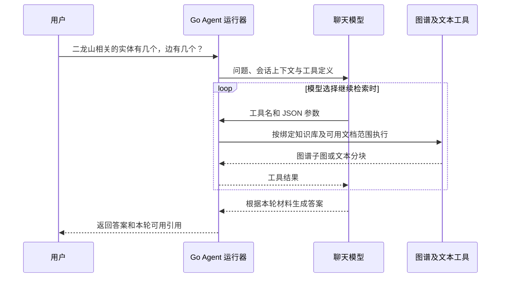

# 从「二龙山有几条边」看 RAGFlow Agent 的工具调用

用户在绑定《水浒传》知识图谱的会话中问「二龙山相关的实体有几个，边有几个？」。最终回答给出 **10 个实体、11 条关系**，并列出了 8 个人物、2 个地点以及 11 条语义关系。这个案例展示了 Agent 如何在图谱探索与原文检索之间切换，以及为什么有出处的关系叙述仍可能无法回答精确的图谱计数问题。

材料包括用户提供的模型可见叙述、最终回答与当前仓库源码。附件没有逐次工具事件、调用 ID 或完整响应 XML。下文按附件中提及的先后整理，查询措辞和返回内容以叙述能支持的细节为限。

## 从提问到回答

进入 Agentic RAG 路径时，服务把用户消息、租户、会话绑定的知识库以及文档范围传入 `agentic_rag.Run`。运行器为本轮准备工具。模型可以返回带工具名和 JSON 参数的工具调用，Go 运行时执行对应工具，再把结果交给模型继续选择工具或生成回答。工具选择依赖模型输出和本轮工具配置，源码没有为「实体有几个」硬编码下列固定顺序。正常回答由探索阶段收集。探索失败或没有可用正文时，代码还会尝试从消息恢复答案，或执行备选的答案合成。本案例的附件未记录具体走了哪条收尾分支。 [对话入口](../../internal/service/agentic_pipeline.go#L261) · [工具装配](../../internal/agentic_rag/compiled_knowledge.go#L94) · [运行与收尾](../../internal/agentic_rag/agent.go#L530)

## 本案例的工具轨迹

| 顺序 | 附件提及的工具或动作 | 源码行为与本次观察 |
|---|---|---|
| 1 | `search_bm25_chunks` | 按关键词定位文本分块。附件回顾了早先的 BM25 结果，其中提及二龙山头领和相关人物。最初的参数和完整结果缺失。 [BM25](../../internal/agentic_rag/tool_search_bm25_chunks.go#L129) |
| 2 | 首次 `graph_explore` | 模型把问题转向图谱探索。附件称该查询未匹配到实体。缺少原始 XML，因此无法核实是查询未命中，还是知识库或文档范围内的图谱不可用。 [图谱探索](../../internal/agentic_rag/tool_graph_explore.go#L111) |
| 3 | `search_semantic_chunks` | 用向量检索找与二龙山主题相关的文本分块。附件随后使用有关头领、入伙和夺取宝珠寺的文本描述。 [语义检索](../../internal/agentic_rag/tool_search_semantic_chunks.go#L137) |
| 4 | `graph_doc_outline` | 这个工具面向文档级图谱骨架。只提供查询词时会先定位文档，再返回相应文档的骨架。附件提到结果偏向史进、少华山等主题。即使同属一本书，文档级骨架也可能优先展示其他主题。 [文档骨架](../../internal/agentic_rag/tool_doc_outline.go#L158) |
| 5 | `grep_chunks` | 用正则匹配定位分块。附件提到找到了部分不聚焦于二龙山的内容，随后再次考虑收窄检索措辞。附件缺少完整参数，无法核实具体匹配式或确认是否发出了这些后续查询。 [正则查找](../../internal/agentic_rag/tool_grep_chunks.go#L142) |
| 6 | 再次参考 `graph_explore` | 附件从改写查询转入讨论一个子图结果，提到 `entities="40"` 以及杨志、鲁智深指向二龙山的不同类型关系。原始响应缺失，无法核实重试参数、边数或实际返回的节点全集。 [XML 输出](../../internal/agentic_rag/tool_graph_explore.go#L182) |
| 7 | 综合文本与子图，回答 10 个实体、11 条边 | 最终回答把文本中的人物与地点汇总，按语义列出关系。它没有给出固定图谱查询范围、完整边集或程序计数结果，因而这两个数字只代表本轮回答所列出的项目。 |

## 为什么 `graph_explore` 的计数不能直接作答

1. **先选种子，再扩展关系。** `KgAdapter.Explore` 按知识库搜索种子实体。有查询向量时，先做向量候选检索，再按提及次数重排，每个知识库最多选 2 个种子。缺少查询向量时走文本查询。之后沿边的起点和终点做最多 2 跳扩展，每个方向的关系检索最多取 32 条。这个过程可能同时带出多个种子的邻居。 [种子与扩展](../../internal/agentic_rag/kg_service.go#L195) · [种子搜索](../../internal/agentic_rag/kg_service.go#L372)
2. **工具返回的是有上限的子图。** XML 渲染前分别截到最多 40 个实体、60 条关系和 6 段原文，`entities` 与 `relations` 统计的是截取后的输出。即使附件里的 `entities="40"` 来自原始响应，也只代表这次展示了 40 个节点。 [输出截取与计数](../../internal/agentic_rag/tool_graph_explore.go#L182)
3. **空结果需要区分两种情况。** 工具为图谱不可用返回 `error="no compiled knowledge graph"`，而查询未命中返回普通提示。前者会让 Agent 停止尝试该图谱工具，后者允许用实体名改写再查。附件只有模型对首次空结果的描述，无法据此判断「二龙山没有被编译」。 [空结果处理](../../internal/agentic_rag/tool_graph_explore.go#L154)
4. **关系条数取决于统计键。** 附件提到杨志到二龙山可能同时存在 `located_in` 与 `part_of`。按有方向的关系类型三元组统计时，这是两条边。按无向人物对统计时，同一对端点只计一次。原文能够支持某种关系，也可能尚未被编译为图谱中的边。 [遍历中的关系标识](../../internal/agentic_rag/kg_service.go#L251)

## 如果产品要支持精确计数

可以增加一个明确的图谱计数入口，把确定性统计交给后端。以下是技术分享中的设计示例。

- **先定义范围。** 例如统计当前知识库中「二龙山」节点的一跳入边和出边。说明实体总数是否含二龙山本身，以及是否合并「二龙山宝珠寺」等候选别名。别名合并应基于图谱中的明确映射或产品约定。
- **通过索引查询完整边集。** 精确定位节点后，在会话允许的知识库、文档和产物范围内分页查询两端命中该节点的关系。选定去重口径，例如按有向三元组 `(from, type, to)` 计边，再按照明确的实体标识统计邻居。
- **返回统计口径和结构化计数。** 工具结果可以包含查询范围、匹配节点、入边数、出边数、去重后边总数、唯一邻居数及是否含中心节点。Agent 负责解释这些字段。文本工具仍可提供证据段落，帮助用户理解关系。

在本案例的记录下，可以准确地向用户表述为「根据本轮查到的材料，我整理了 10 个主要实体和 11 条叙事关系。精确的图谱计数需要按二龙山节点和明确的边范围查询。」
